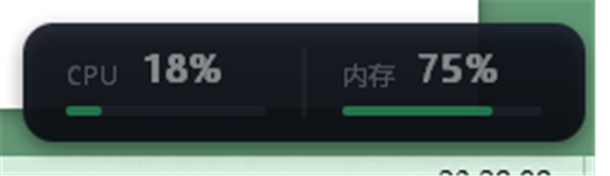

# SK-vitals

Windows 任务栏资源监控：贴靠托盘区的悬浮小窗显示 **CPU / 内存** 占用，托盘图标随负载变色告警。
Rust 原生 Win32 实现，无运行时依赖，常驻几乎不占资源。



## 特点

- **真的不占资源**：单文件 exe 约 100 KB，常驻 1 个线程、约 8 MB 工作集，CPU 占用接近 0。
  没有 Electron / 浏览器内核 / .NET 运行时，纯 Win32 + GDI。
- **悬浮小窗贴靠任务栏**：自动定位在托盘通知区正上方（找不到托盘时退回屏幕右下角），
  显示 CPU、内存百分比和彩色进度条，每秒刷新；小窗可拖动，不上任务栏、不抢焦点。
- **托盘变色告警**：负载正常时图标为绿色，偏高转黄，过高转红；悬停 tooltip 显示实时数值和告警文案。
- **不打扰**：默认不发通知、不弹窗，只在颜色和 tooltip 上体现；也不需要管理员权限。
- **开机自启开关**：托盘菜单里勾选即可，写入当前用户的启动项，取消勾选即删除。
- **单实例**：重复启动只会把已经运行的悬浮窗显示出来，不会多开。
- **健壮**：explorer 重启（任务栏重建）后自动重新挂上托盘图标；DPI 变化、分辨率变化、任务栏移动时重新贴合。

## 操作

| 操作 | 效果 |
|---|---|
| 左键单击托盘图标 | 显示 / 隐藏悬浮小窗 |
| 右键单击托盘图标 | 菜单：显示/隐藏悬浮窗、开机自启（勾选状态即当前开关）、退出 |
| 拖动悬浮窗 | 临时移动位置（任务栏/分辨率变化后会重新贴合） |

## 告警阈值

在 [src/stats.rs](src/stats.rs) 顶部修改：

| 指标 | 偏高（黄） | 过高（红） |
|---|---|---|
| CPU | 80% | 95% |
| 内存 | 80% | 92% |

托盘图标取 CPU 与内存中更严重的那一档颜色。

## 使用

双击 `sk-vitals.exe` 即可，无控制台窗口、无安装步骤。

开机自启：右键托盘图标 → 「开机自启」勾选即可，再次点击取消。开启时程序会把自己的完整路径
写入 `HKCU\Software\Microsoft\Windows\CurrentVersion\Run`（值名 `SK-vitals`，路径带引号），
只影响当前用户、无需管理员权限；取消时删除该值。**移动或重命名 exe 后需要重新勾选一次**。

> Windows 11 默认会把新注册的托盘图标收进「隐藏的图标」面板。想常驻可见，
> 点任务栏的 `^` 把 SK-vitals 拖到托盘可见区固定一次即可。

## 编译

需要 Rust 工具链 + MSVC Build Tools（Windows SDK）：

```powershell
cargo build --release
```

产物：`target/release/sk-vitals.exe`（几百 KB 以内，已开启 LTO / strip / opt-level=z）。

## 实现说明

- CPU：`GetSystemTimes` 两次采样的 idle/total 差值，每秒一次，不轮询进程列表。
- 内存：`GlobalMemoryStatusEx` 的 `dwMemoryLoad`。
- 界面：`WS_POPUP` + `WS_EX_TOOLWINDOW | WS_EX_TOPMOST | WS_EX_NOACTIVATE` 无边框窗口，
  GDI 双缓冲自绘，`SetWindowRgn` 圆角。
- 托盘图标：运行时用 GDI 画进 32×32 DIB，`CreateIconIndirect` 生成 `HICON`，按等级换色。
- 依赖：仅 `windows-sys`（Win32 绑定）。

## 作者

**柯夜**（Ke Ye）— [github.com/sickpoet](https://github.com/sickpoet)

仓库：[github.com/sickpoet/SK-vitals](https://github.com/sickpoet/SK-vitals)

## License

MIT
